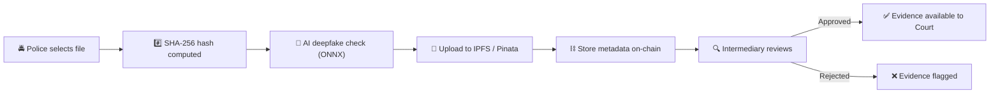
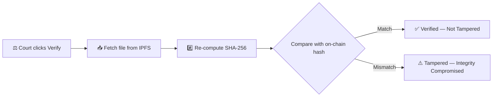
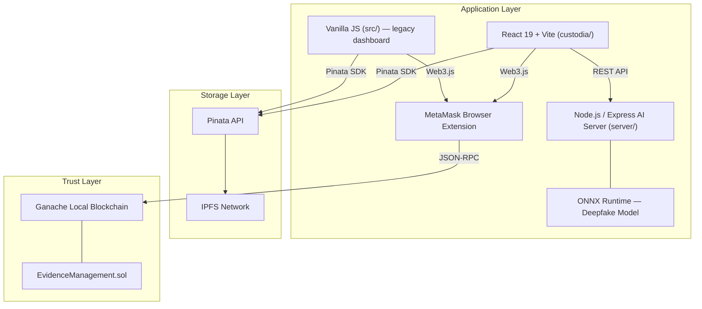
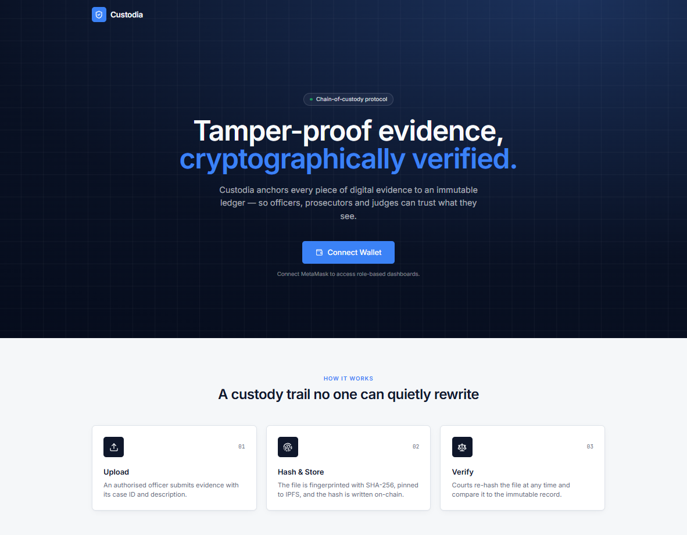
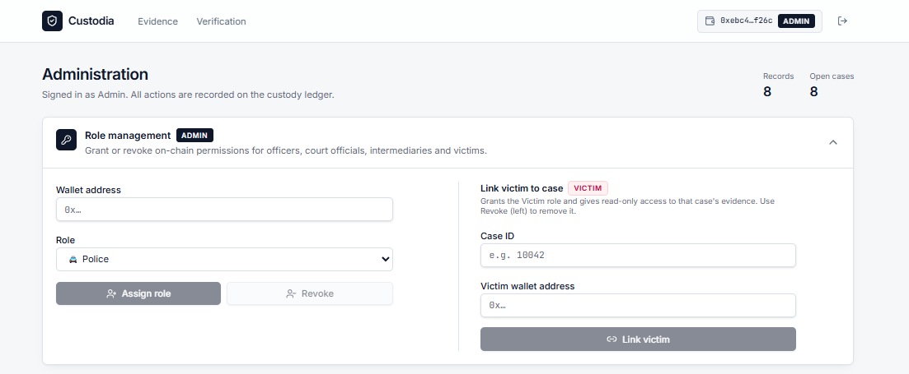
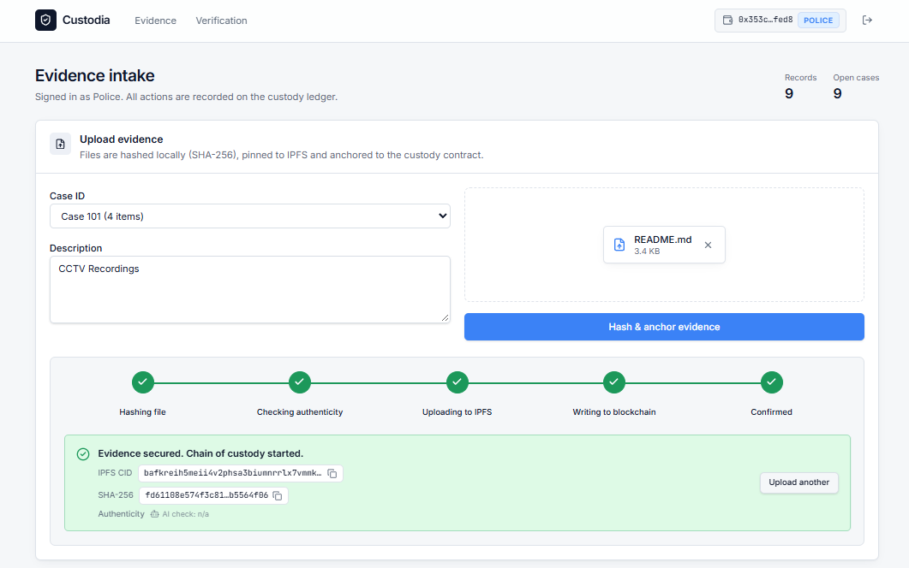
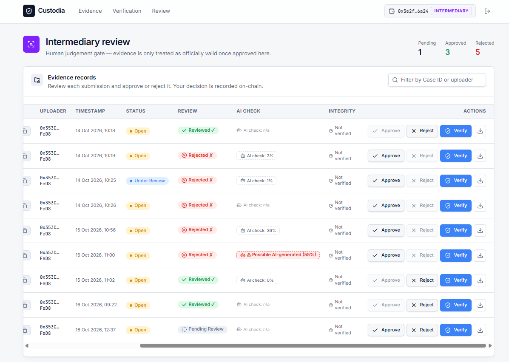
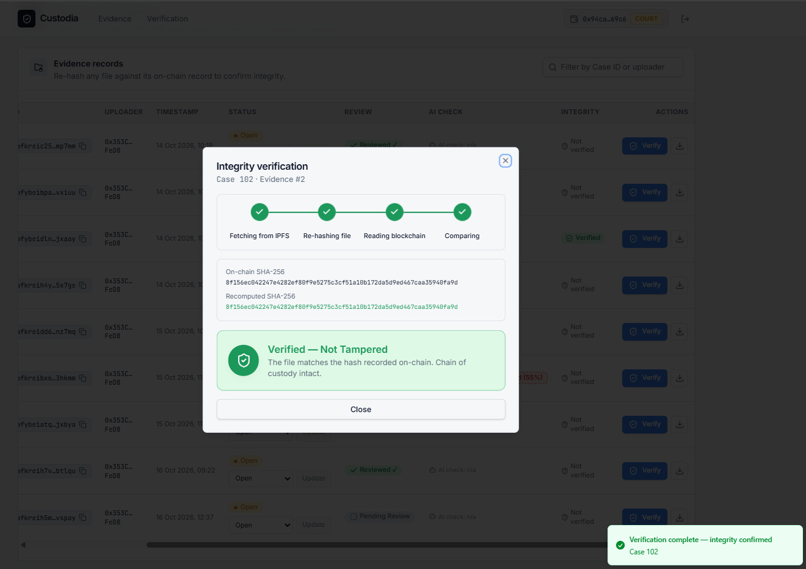
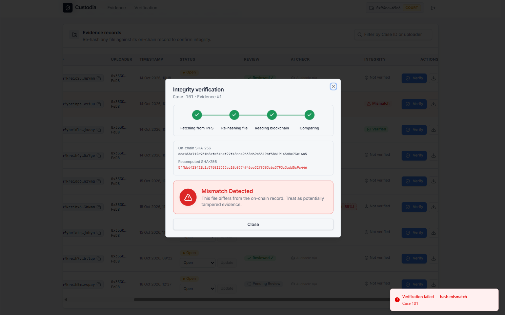
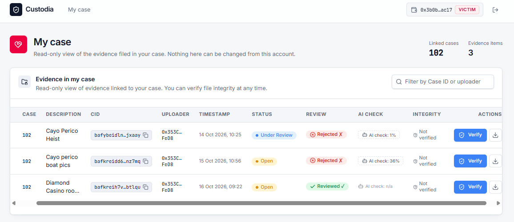

<h1 align="center">🛡️ Custodia — Evidence Management Blockchain</h1>

<p align="center">
  <em>Tamper-proof digital evidence storage with on-chain integrity, AI deepfake detection, and multi-role access control.</em>
</p>

<p align="center">
  
  
  
  
  
  
  
  
</p>

---

## 📖 Overview

### The Problem

Traditional digital evidence management suffers from critical vulnerabilities:

- **Tampering** — files can be silently altered after collection, destroying chain-of-custody guarantees.
- **AI-generated fakes** — deepfake images and videos can be submitted as genuine evidence.
- **No independent review** — evidence enters the legal pipeline without third-party verification.

### The Solution

**Custodia** eliminates these risks through a three-layer architecture:

1. **Immutable hashing** — every file's SHA-256 hash is computed client-side and stored on-chain, creating a tamper-proof fingerprint.
2. **Decentralised storage** — files are pinned to IPFS via Pinata, ensuring availability without a single point of failure.
3. **Smart-contract RBAC** — a 5-role access-control system (Admin, Police, Intermediary, Court, Victim) enforced directly in Solidity, not just in the UI.
4. **AI deepfake detection** — a local ONNX model scores every uploaded image/video for AI-generation likelihood *before* it reaches the chain.
5. **Intermediary review** — an independent reviewer can approve or reject evidence before the court acts on it.

---

## ✨ Key Features

| Feature | Description |
|---------|-------------|
| **SHA-256 on-chain hashing** | File integrity fingerprint stored immutably on Ethereum |
| **IPFS storage via Pinata** | Decentralised, content-addressed file storage |
| **5-role RBAC** | Admin, Police, Intermediary, Court, Victim — enforced at the smart-contract level |
| **AI deepfake detection** | Local ONNX model (`deepfake_vs_real_image_detection`) run via `@xenova/transformers`; video files get multi-frame extraction with ffmpeg |
| **Intermediary approve / reject** | Independent third-party review before court access |
| **Read-only Victim role** | Victims can view evidence for their assigned case without any write access |
| **Case-ID dropdown** | Officers can file evidence under existing or new cases |
| **Tamper verification** | Court can re-download from IPFS, re-hash, and compare against the on-chain hash |

---

## 🔄 How It Works

### Upload Flow

1. **Police officer** selects a file, enters a Case ID and description.
2. The browser computes the **SHA-256 hash** of the file.
3. The file is sent to the local **deepfake detection server** (ONNX); a fake-score (0–100) is returned.
4. The file is uploaded to **IPFS via Pinata**; a CID is returned.
5. The smart contract's `addEvidence()` is called, storing `(caseId, CID, SHA-256 hash, description, aiFakeScore)` on-chain.
6. The **Intermediary** reviews and approves/rejects the evidence.



### Verification Flow

1. **Court official** clicks "Verify" on an evidence record.
2. The file is re-fetched from IPFS using the stored CID.
3. The SHA-256 hash is re-computed on the downloaded file.
4. The re-computed hash is compared against the on-chain hash.
5. **Match** → ✅ Verified / **Mismatch** → ⚠️ Tampered.



---

## 👥 Roles & Permissions

| Role | Assigned By | Capabilities |
|------|-------------|-------------|
| **Admin** | Deployer of the contract (auto-assigned) | Assign / revoke all roles, assign victims to cases |
| **Police** | Admin | Upload evidence, select case ID, trigger AI check |
| **Intermediary** | Admin | Review (approve / reject) uploaded evidence |
| **Court** | Admin | View all evidence, verify file integrity, update case status |
| **Victim** | Admin (linked to a case) | Read-only view of evidence for their assigned case |

---

## 🏗️ Architecture



---

## 🧰 Tech Stack

| Layer | Technology |
|-------|-----------|
| Smart Contract | Solidity ^0.8.19 |
| Contract Framework | Truffle 5.x |
| Local Blockchain | Ganache (port 7545) |
| Frontend (main) | React 19, Vite 8, Tailwind CSS 4, React Router 6 |
| Frontend (legacy) | Vanilla HTML/CSS/JS |
| Backend / AI Server | Node.js, Express, `@xenova/transformers`, ONNX Runtime, ffmpeg |
| Decentralised Storage | IPFS via Pinata |
| Wallet | MetaMask |
| Hashing | Web Crypto API (SHA-256) |

---

## 📁 Project Structure

```
evidence-management-system/
├── contracts/
│   └── EvidenceManagement.sol        # Solidity smart contract (5-role RBAC + evidence storage)
├── migrations/
│   └── 1_deploy_contracts.js         # Truffle deployment script
├── scripts/
│   └── sync-config.js               # Post-deploy: syncs ABI + address into both frontends
├── src/                              # Legacy vanilla JS dashboard
│   ├── index.html                    #   Officer / Admin page
│   ├── court.html                    #   Court verification page
│   ├── app.js                        #   Officer page logic
│   ├── court.js                      #   Court page logic
│   ├── config.js                     #   Config (contract address, ABI, Pinata keys)
│   └── style.css                     #   Styles
├── custodia/                         # React (Vite) frontend — main UI
│   ├── src/
│   │   ├── App.jsx                   #   Router setup
│   │   ├── config.js                 #   Config (contract address, ABI, Pinata keys)
│   │   ├── main.jsx                  #   Entry point
│   │   ├── styles.css                #   Global styles
│   │   ├── lib/
│   │   │   ├── custodia.jsx          #   Core context: wallet, contract, IPFS, deepfake
│   │   │   └── utils.js              #   Tailwind merge helper
│   │   ├── components/
│   │   │   ├── custodia/             #   Domain components (AdminPanel, UploadPanel, etc.)
│   │   │   └── ui/                   #   Reusable UI primitives (Button, Dialog, Input…)
│   │   └── pages/                    #   Route pages (Landing, Dashboard, Court, Intermediary, Victim)
│   ├── public/                       #   Static assets (favicon, icons)
│   ├── vite.config.js                #   Vite configuration
│   └── package.json
├── server/                           # Express deepfake-detection API
│   ├── index.js                      #   Server entry — ONNX model, ffmpeg frame extraction
│   ├── .env.example                  #   Environment variable template
│   └── package.json
├── docs/
│   └── screenshots/                  #   App screenshots (see below)
├── build/                            #   Truffle compile output (git-ignored)
├── truffle-config.js                 #   Truffle network & compiler settings
├── package.json                      #   Root package — Truffle scripts
├── LICENSE                           #   MIT License
└── README.md                         #   This file
```

---

## 📋 Prerequisites

| Requirement | Version | Notes |
|-------------|---------|-------|
| **Node.js** | ≥ 18.11 | Required by `@xenova/transformers` |
| **npm** | ≥ 9 | Ships with Node 18+ |
| **Ganache** | Any | GUI or CLI — must listen on port **7545** |
| **MetaMask** | Latest | Browser extension |
| **Pinata account** | Free tier | Get API key + secret at [app.pinata.cloud/keys](https://app.pinata.cloud/keys) |

---

## 🚀 Setup & Run

### 1. Clone the repository

```bash
git clone https://github.com/<your-username>/evidence-management-system.git
cd evidence-management-system
```

### 2. Install dependencies

```bash
# Root (Truffle)
npm install

# React frontend
cd custodia
npm install
cd ..

# AI deepfake detection server
cd server
npm install
cd ..
```

### 3. Start Ganache

Open Ganache (GUI) or run:

```bash
npx ganache --port 7545
```

> Note the **first account address** — it becomes the contract admin.

### 4. Compile & deploy the smart contract

```bash
npx truffle migrate --reset
```

### 5. Sync the contract address & ABI into both frontends

```bash
npm run sync-config
```

This updates `src/config.js` and `custodia/src/config.js` with the freshly deployed address and ABI.

### 6. Configure environment variables

```bash
# Server
cp server/.env.example server/.env
# Edit server/.env — set PORT (default 4000)

# Custodia (if using env vars for Pinata — optional, keys are in config.js)
cp custodia/.env.example custodia/.env
# Edit custodia/.env — set VITE_PINATA_API_KEY and VITE_PINATA_SECRET_API_KEY
```

> **Also update `src/config.js` and `custodia/src/config.js`** with your Pinata API key and secret (the `sync-config` script preserves these fields).

### 7. Start the deepfake detection server (port 4000)

```bash
cd server
npm start
cd ..
```

The server downloads the ONNX model on first run (~100 MB). Subsequent starts are instant.

### 8. Start the React frontend (port 5173)

```bash
cd custodia
npm run dev
```

Open [http://localhost:5173](http://localhost:5173) in your browser.

### 9. Configure MetaMask

1. **Add network:**
   - Network Name: `Ganache Local`
   - RPC URL: `http://127.0.0.1:7545`
   - Chain ID: `1337`
   - Currency Symbol: `ETH`
2. **Import accounts** — click the 🔑 icon in Ganache to copy a private key, then in MetaMask → Import Account → paste the key. Import at least **5 accounts** (Admin, Police, Intermediary, Court, Victim).

---

## 🎮 Demo Walkthrough

### Assign Roles (Admin — Account 1)

1. Open [http://localhost:5173](http://localhost:5173) and click **Connect Wallet**.
2. Select **Account 1** (deployer = Admin). The Admin Panel appears.
3. Paste **Account 2** address → select **Police** → click **Assign Role**.
4. Paste **Account 3** address → select **Intermediary** → click **Assign Role**.
5. Paste **Account 4** address → select **Court** → click **Assign Role**.
6. Paste **Account 5** address → select **Victim** → **Assign Victim to Case** (e.g., Case 1001).

### Upload Evidence (Police — Account 2)

1. Switch MetaMask to **Account 2**, refresh the page.
2. Go to **Dashboard** → the Upload Evidence panel is visible.
3. Enter Case ID `1001`, a description, and drag-drop a file.
4. Click **Upload** → watch the step tracker: Hash → AI Check → IPFS → Blockchain → ✓ Done.

### Review Evidence (Intermediary — Account 3)

1. Switch to **Account 3**, navigate to `/intermediary`.
2. See pending evidence → click **Approve** or **Reject**.

### Verify Evidence (Court — Account 4)

1. Switch to **Account 4**, navigate to `/court`.
2. Click **Verify** on any evidence row.
3. The system fetches from IPFS, re-hashes, and shows **✅ Verified** or **⚠️ Tampered**.

### View Evidence (Victim — Account 5)

1. Switch to **Account 5**, navigate to `/victim`.
2. See read-only evidence for Case 1001.

---

## 🔓 Tamper Demo

To demonstrate tamper detection:

1. Upload a file as Police (Account 2) — note the evidence ID.
2. Go to [Pinata Cloud](https://app.pinata.cloud) and **unpin** the file.
3. Pin a **different file** with the same CID name (or modify via gateway override).
4. As Court (Account 4), click **Verify** on that evidence.
5. The re-computed SHA-256 hash will **not match** the on-chain hash → **⚠️ Tampered** is displayed.

> **Simpler alternative:** In the browser console, manually modify the `fileHash` value returned by `getEvidence()` before the comparison runs, and observe the UI switch to "Tampered."

---

## 📸 Screenshots

> **Add your screenshots to `docs/screenshots/` and they will render here.**

| Screen | Preview |
|--------|---------|
| Landing Page |  |
| Admin Panel |  |
| Evidence Upload |  |
| Intermediary Review |  |
| Court — Verified |  |
| Court — Tampered |  |
| Victim View |  |

---

## ⚠️ Limitations

- **AI model scope** — the deepfake detector classifies single frames and was trained on older generators; it may miss outputs from newer models (e.g., DALL-E 3, Midjourney v6, Sora).
- **Victim filtering is UI-level** — all evidence data is publicly readable on-chain (Ganache has no access control at the RPC level). The Victim role's case filtering is enforced only in the frontend.
- **Ganache test network only** — this project is designed for local development. Deploying to a public testnet or mainnet would require gas funding, a persistent node, and key management.
- **Pinata keys in client code** — acceptable for a demo; production systems should proxy Pinata calls through a backend.

---

## 🔮 Future Scope

- **Deploy to a public testnet** (Sepolia / Polygon Mumbai) with persistent storage.
- **Backend proxy** for Pinata to remove client-side API keys.
- **Upgraded AI model** — fine-tune on newer generator outputs; add audio deepfake detection.
- **Multi-frame video analysis** — classify more frames and use temporal consistency checks.
- **On-chain access control for Victims** — use `require` checks in the contract to restrict `getEvidence()` to authorised callers.
- **Audit trail** — store all status transitions and reviews as on-chain events with timestamps.
- **Mobile support** — integrate with WalletConnect for mobile wallet usage.

---

## 👨‍💻 Authors

- **Atharva Palande**
- **Krish Pitrola**

---

## 📝 License

This project is licensed under the [MIT License](LICENSE).
